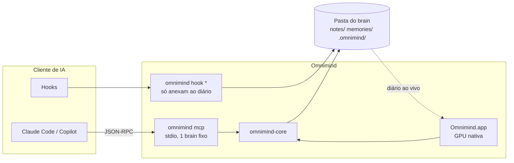

# Arquitetura

Tudo em Rust. Nenhum processo fica ligado com o app fechado: o servidor MCP nasce com a sessão do cliente de IA e morre com ela.

## Crates

| Crate | Papel | Depende de |
|---|---|---|
| `gfx` | wgpu, cena instanciada, atlas de glifos | wgpu, cosmic-text |
| `ed` | Texto, seleção, desfazer, Markdown por linha. Sem GPU | ropey |
| `graph` | Geometria de Feixes e Raízes. Sem GPU, sem janela | bytemuck |
| `omnimind-core` | Brain, diário, escrita, busca, ciclo de vida | Sem tokio, sem SQLite |
| `omnimind-cli` | Binário `omnimind`: MCP, hooks, CLI, `connect` | core |
| `app` | Telas, grafo, harness, janela | todos |

## Threads do app

| Thread | Faz | Nunca |
|---|---|---|
| Principal | Eventos, quadro, GPU | Toca disco |
| `data` | Único dono do `Brain`; lê o diário, grava notas | Espera a interface |
| `graph` | Nasce a cada reconstrução, monta a geometria e entrega por canal | Bloqueia o quadro |
| `fonts` | Varre fontes do sistema depois do primeiro quadro | Atrasa a abertura |

A interface conversa com `data` por canais (`Cmd`, `Msg`). Saída passa por um único caminho: `flush_all` → `Closing` → última gravação → `Shutdown`, e o laço espera a thread terminar antes de sair. `applicationShouldTerminate:` é pendurado no delegate para que Cmd+Q, Dock e logout caiam no mesmo caminho.

## Grafo

Duas formas, decididas em `decisions/0006-redesign-omnimind.md`:

| Forma | Técnica | Referência |
|---|---|---|
| Feixes | Itens em círculo, ligações agrupadas por subtema e tema | Hierarchical edge bundling, Holten 2006 |
| Raízes | Cada tema cresce do centro; onde há mais uso, o galho engrossa | Space colonization, Runions 2007 |

`crates/graph` é geometria pura: recebe nós e ligações, devolve fitas de triângulos e pontos. Não toca GPU nem janela. O mesmo nó, pela chave estável, fica perto do mesmo lugar entre reconstruções.

`GraphView`, em `crates/app/src/graphview`, recebe a geometria e desenha com wgpu numa textura fora da tela. A cena só compõe essa textura. Mistura aditiva no tema escuro e subtração reversa no claro. A textura só é redesenhada quando algo mudou. Acima de 6.000 itens, ela usa no máximo 1,5x, para a animação seguir fluida.

Três animações: abertura, leitura ao vivo pelos eventos `Live::Read` do diário, e criação de item novo. Não há física, zoom nem arrastar.

## Métricas

`stats.rs` lê o diário na thread de dados e entrega números prontos no instantâneo. A tela só desenha. Nenhuma métrica é estimada.

## Multi-processo

Sem estado compartilhado além do disco:

- Cada processo tem índice próprio em RAM; o instantâneo é descartável.
- Antes de consultar: `stat` na árvore, com a regra de 2 s do git para arquivo recém-tocado.
- Escrita sob trava que morre com o processo, com compare-and-swap por hash.
- Diário com um segmento por processo: anexar nunca disputa arquivo.

## Decisões de quadro

Medidas, não presumidas:

| Decisão | Medição |
|---|---|
| Latência de swapchain 2 | Com 1: 20 a 35 quadros perdidos em 300. Com 2: nenhum |
| Sem cursor piscando | Zero quadros em repouso: 0 em 4 s |
| Grafo em textura própria | Janela real, 300 quadros: p50 16,67 ms, p99 17,05 ms, 0 acima de 20 ms |
